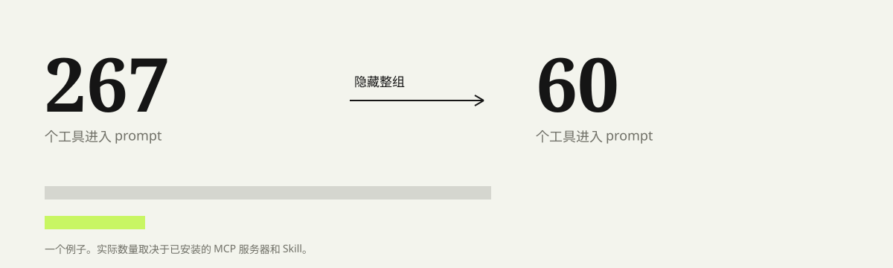

# Toolgate

**0.1.3** adds the operation audit log, backup retention cap, the `allowSessionOverride` config and stricter API validation. See [Changelog](CHANGELOG.md) and [Security](SECURITY.md).

Manage MCP servers and skills in DeepSeek Harness, and choose which tools enter the next prompt.

[中文](README.md)

Every MCP tool carries a full JSON Schema into the request. A server with dozens of tools can take up more context than the conversation itself.



The plugin separates configuration from exposure. Configuration owns servers and skills; exposure decides which schemas this turn carries.

## Install

```sh
dsh plugin --profile <profile> add https://github.com/jidekaixin2dian/dsh-toolgate/releases/latest/download/dsh-toolgate.tgz
```

On the desktop app, install through its plugin manager when that manager owns the profile. After installing or updating the host half, quit and reopen DSH. The desktop app has no browser-style `Ctrl+R` hard refresh.

Requires Node >=24. Management endpoints require the host's `connection.requestRejection()` and current `profileContext`; integration tests pin DSH **0.2.1-rc.3**. Missing authentication closes the endpoint. A missing profile never falls back to an arbitrary installed profile.

## Use

Open **Settings -> Toolgate**.

**Toolgate** groups tools by MCP server, hides the groups this turn does not need, and restores them later. MCP processes keep running. All visible, hide all MCP, hide largest group and lean mode live here.

**MCP servers** add, edit, remove, enable or disable in the selected profile/global patch files, applied through HMR. YAML edits preserve sibling entries, unknown fields and comments. Originals are backed up under `DSH_HOME/backups/toolgate/`, keeping only the 20 most recent copies after successful writes. Every management write appends an audit line (operation, target, outcome, timestamp — never secret values) to `DSH_HOME/toolgate-audit.jsonl`. Environment/header values are not returned to the client: leave their replacement controls unchecked to retain them; checking a control and leaving it empty explicitly clears that map.

Effective state follows the host: bundle → profile → global → launcher overlays. Toggles update the last writable layer. Editing keeps the definition in its original layer. Ambiguous IDs, dynamic target nodes, config overrides and read-only sources are rejected when they cannot be safely edited.

**Skills** select a Session workspace before listing, creating, deleting or toggling. Project roots follow the host's nearest-`.git` rule, falling back to the Session cwd; user roots use the selected DSH_HOME. Rows retain provider/source/path identity. Only matching local `.dsh/skills/<name>/SKILL.md` directory bundles can move to `.trash`. Shared `.agents`, bundled, custom and virtual sources are read-only. Scoped providers that cannot be overridden have their toggle disabled.

Model tool:

```text
toolgate action=status
toolgate action=session disabled=["mcp:github", "skills"]
toolgate action=reset
```

`mcp` is the wildcard for all MCP servers; `mcp:<server>` targets one. The settings page applies globally to sessions and subagents; `action=session` overrides only the current session.

Set `allowSessionOverride: false` in the plugin config to make the model tool read-only: `action=session` and `action=reset` return a notice and change nothing, while the global gate stays editable on the settings page. Use it when prompt injection might otherwise talk an agent into hiding audit tooling.

## How it works

The budget half uses per-instance state and `ctx.tools.restrict({ deny })` during `agent/pre-step`. Unload lifts owned restrictions; Agent disposal clears its state. The MCP half edits parsed YAML nodes and uses the host composer for effective state. The skill half uses a rank-0 override provider with persisted source identities and project roots.

Token numbers estimate serialized schema/description character counts, not provider tokenization, costs or latency. Known unhideable scoped tools are excluded from projected savings.

## Boundaries

- A dynamic MCP manager that registers tools in the agent scope cannot be hidden by `ctx.tools.restrict`; use that manager's unload.
- MCP CRUD writes `cordis.patch.yml`. Review the diff if you hand-edited the file.
- ZIP or folder import of skills is not implemented. A skill found only in a scoped provider may not be hideable.
- Host and client half updates both need an app restart.
- Hiding tools is context budgeting, not a permission sandbox. Session overrides can restore groups; MCP processes keep running.
- Configuration backups contain original secrets. Keep them private; see [SECURITY.md](SECURITY.md).

## Development

```sh
npm ci --ignore-scripts --legacy-peer-deps
npm test
npm run setup:host
npm run test:host
npm run pack:check
```

Git and pnpm are required; the pinned host uses pnpm 11.28.5. Host source and temporary DSH_HOME data stay under `work/`, without production profiles or API keys. `TOOLGATE_HOST` can select an existing clean checkout at the exact pinned commit.

Unit regressions cover precise YAML changes, complex arguments, patch precedence, failed-write rollback and path/source identity. The host suite uses real Cordis/tools/skills, HTTP and Cookie authentication. With `TOOLGATE_BROWSER=1` it also exercises the actual React settings page in Edge on Windows or Chromium on Linux (`npx --no-install playwright install --with-deps chromium`). CI runs unit, host, browser and package-install checks on Windows and Linux. These settings tests do not certify the complete Desktop shell or real-model behavior.

[GitHub](https://github.com/jidekaixin2dian/dsh-toolgate) · [Releases](https://github.com/jidekaixin2dian/dsh-toolgate/releases) · MIT


## Release verification

Published releases are checked for tag/version consistency, archive files matching tagged source, and the GitHub download digest. Run **Release integrity** in Actions with a published tag to recheck it. Historical tags and assets remain unchanged.
