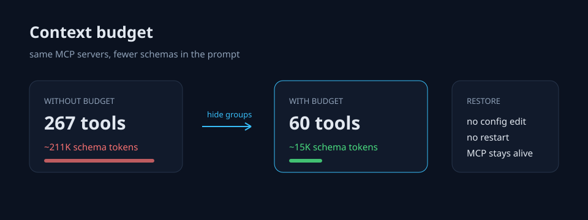

# dsh-context-budget

**Manage MCP servers and toggle skills in DeepSeek Harness — and hide tool groups from the next prompt with token-cost estimates.** Budget changes need no config edit, no restart and no MCP process churn; MCP server edits write the normal patch file and apply through HMR.



## Why

Every MCP tool is sent as a full JSON Schema on every request. A server with dozens of tools can quietly consume more context than the conversation itself. Configuration managers can add, remove or toggle servers, but the prompt is still paid on the next turn.

This plugin manages three things in one page:

- **MCP servers** — list, add, edit, remove, enable/disable; writes the profile/global `cordis.patch.yml` and lets HMR apply it.
- **Skills** — search, create, delete, and enable/disable one skill through a rank-0 override provider.
- **Prompt budget** — group the effective tools by MCP server, hide a whole group, see the approximate cost, and restore it without restarting the MCP process.

## Install

From GitHub (no build step; `lib/` is included):

```sh
dsh plugin --profile <your-profile> add github:jidekaixin2dian/dsh-context-budget
```

For the official desktop app, install through its plugin manager if it manages the profile for you. Restart DSH once after installing the host half, then hard-refresh the web UI.

## Use

Open **Settings → Context budget**:

- **Context budget** tab:
  - **All visible** — clear every override;
  - **Hide all MCP** — one switch for every `mcp__<server>__*` group;
  - **Hide largest group** — the group with the biggest schema cost;
  - **Lean** — MCP + Skill + memory + schedule off;
  - per-server MCP rows, Skill catalog, memory tools, schedule tools.
- **MCP servers** tab: add/edit/remove, enable/disable; stdio command/args/env or streamable-http URL/headers.
- **Skills** tab: search, create/delete user or project skills, and toggle individual skills.

A read-only **Core tools** row is always kept.

Model tool:

```text
context_budget action=status
context_budget action=session disabled=["mcp:github", "skills"]
context_budget action=reset
```

`mcp` is a wildcard for all MCP servers; `mcp:<server>` targets one. The global budget applies to every session and subagent; `action=session` only overrides the current session.

## How it works

The budget half applies `ctx.tools.restrict({ deny })` on the agent scope during `agent/pre-step`. The tool schemas are removed from prompt assembly before the request is sent. It listens to `tools/change`, `agent/created` and `agent/status` so dynamic MCP additions and subagents get the restriction too.

The MCP tab edits the profile/global `cordis.patch.yml` line by line (unrelated rows and comments survive); DSH HMR applies the changed MCP row. The Skill tab registers a rank-0 override provider with `modelInvocable:false` for disabled names.

Token numbers are estimates from the serialized JSON schemas plus Skill catalog descriptions, not a provider tokenizer.

## Compatibility

- **Dynamic MCP managers** that register tools in the agent scope (for example lazy MCP loading) are respected: their tools are shown in the `scoped` count, but `ctx.tools.restrict` cannot hide scoped registrations. Use that manager's own unload.
- **Other MCP/Skills managers** own their own rows and files; this plugin edits only `@deepseek-ai/dsh-mcp-client` rows it manages and its own skill override. `tools/change` picks up their changes.
- **dsh-context** reads request headers; hiding tools here reduces its tool-schema row and the actual prompt together.

## Limits

- MCP processes stay alive when only the budget is used; this saves prompt tokens, not RAM.
- MCP CRUD writes `cordis.patch.yml`; DSH HMR applies it. Review the diff if you hand-edited the file.
- Skill toggles use the global skill registry; a skill discovered only in a scoped provider may not be hidable.
- Skill file import from ZIP/folder is not implemented; create writes `~/.dsh/skills/<name>/SKILL.md` or `<cwd>/.dsh/skills/<name>/SKILL.md`, delete moves to `.trash`.
- Tool descriptions/schemas must be known before a restriction can be computed; a first request may calibrate the full baseline.
- Host-half updates need a DSH restart; client-half updates need a hard refresh.

## Development

```sh
npm test
```

Pure grouping rules are in `lib/groups.js`; the host and browser halves are hand-written ESM/CJS to keep the package dependency-free.

MIT.
