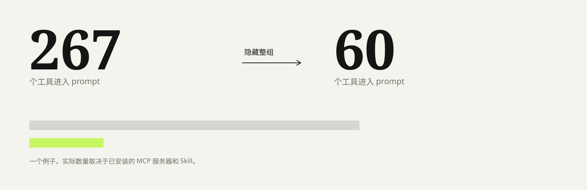

# 上下文预算

在 DeepSeek Harness 里管理 MCP 服务器与 Skill，控制下一轮 prompt 的工具成本。

[English](README.en.md)


每个 MCP 工具都会把完整 JSON Schema 带进请求。工具多的服务器会占掉大量上下文，甚至超过对话本身。

配置管理器能增删服务器，但下一轮 prompt 仍然要付这份成本。这个插件把配置和暴露分开：

**MCP 服务器。** 在设置里新增、编辑、删除、启停，写 profile 或 global 的 `cordis.patch.yml`，HMR 生效。

**Skills。** 搜索、新建、删除、单 Skill 启停。新建可写用户或项目目录，删除会移到 `.trash`。

**上下文预算。** 按 MCP 服务器分组，隐藏这一轮不需要的整组 schema，随时恢复。MCP 进程继续运行。



## 安装

```sh
dsh plugin --profile <profile> add github:jidekaixin2dian/dsh-context-budget
```

桌面端如果由应用自己的插件管理器管理 profile，请在应用内安装。安装或更新 host 半后，退出并重新打开 DSH。桌面端没有浏览器式 `Ctrl+R` 硬刷新，换 client bundle 只能重开应用。

## 使用

打开 **设置 -> 上下文预算**。

### 上下文预算

**全部显示** 清除所有隐藏。**关闭全部 MCP** 一次隐藏所有 `mcp__<server>__*` 分组。**关闭最大组** 按估算 token 选当前最大的一组。**精简模式** 关闭 MCP、Skill、记忆和定时任务。

每个 MCP 服务器一行，另有 Skill 目录、记忆工具和定时任务。核心工具只读保留。

### MCP 服务器

列表显示 serverName、transport、目标、启用状态和写入位置。新增或编辑时可以选择写入 profile 或 global 的 `cordis.patch.yml`。stdio 使用 command/args/env，streamable-http 使用 url/headers。保存后由 HMR 应用，不需要重启。

### Skills

搜索、查看描述、单 Skill 启停。新建 Skill 可写入用户 `~/.dsh/skills` 或项目 `.dsh/skills`。删除会移到 `.trash`，不会硬删除文件。停用通过 rank-0 override provider，不改写 Skill 文件。

模型工具：

```text
context_budget action=status
context_budget action=session disabled=["mcp:github", "skills"]
context_budget action=reset
```

`mcp` 是全部 MCP 的通配，`mcp:<server>` 只针对一台服务器。设置页的全局预算作用于所有会话和子代理，`action=session` 只覆盖当前会话。

## 它怎么工作

预算部分在 `agent/pre-step` 里对 agent 作用域调用 `ctx.tools.restrict({ deny })`，工具 schema 在 prompt 组装前被移除。它监听 `tools/change`、`agent/created`、`agent/status`，动态 MCP 工具和子代理也会被覆盖。

MCP 部分按行编辑 profile 或 global 的 `cordis.patch.yml`，保留无关行和注释，DSH HMR 应用变更。Skill 部分注册 rank-0 override provider，把停用项的 `modelInvocable` 设为 `false`。

token 数按序列化 JSON schema 加 Skill 描述估算，不是模型分词器的精确值。

## 边界

- 动态 MCP 管理器把工具注册在 agent 作用域时，设置页会显示 `scoped` 数量，但 `ctx.tools.restrict` 无法隐藏这类注册，请用对应管理器的 unload。
- 其他 MCP 或 Skills 管理器继续负责它们自己的行和文件。本插件只编辑 `@deepseek-ai/dsh-mcp-client` 行和自己的 override。
- **dsh-context** 读取请求头。本插件隐藏工具后，它的工具 schema 行和实际 prompt 会一起下降。
- 只用预算时 MCP 进程仍然存活，省的是 prompt token，不是内存。
- MCP CRUD 会写 `cordis.patch.yml`。如果手工改过该文件，保存前先看 diff。
- Skill 停用走全局注册表，只在 scoped provider 出现的 Skill 可能无法隐藏。
- ZIP 或文件夹导入 Skill 暂未实现，新建和删除已经支持。
- 需要先知道工具 schema 才能计算限制，首个请求会校准完整基线。
- host 半和 client 半更新都需要重开 DSH。

## 开发

```sh
npm test
```

当前 9 个单元测试覆盖分组规则、MCP 行编辑和 Skill 文件操作。

- `lib/groups.js`：工具分组规则；
- `lib/mcp-config.js`：MCP 行编辑；
- `lib/skills-config.js`：Skill 文件新建与删除；
- `lib/index.js` 和 `lib/client.js`：host 与设置页。

## 链接

- [GitHub 仓库](https://github.com/jidekaixin2dian/dsh-context-budget)
- [Releases](https://github.com/jidekaixin2dian/dsh-context-budget/releases)
- [English README](README.en.md)

MIT
